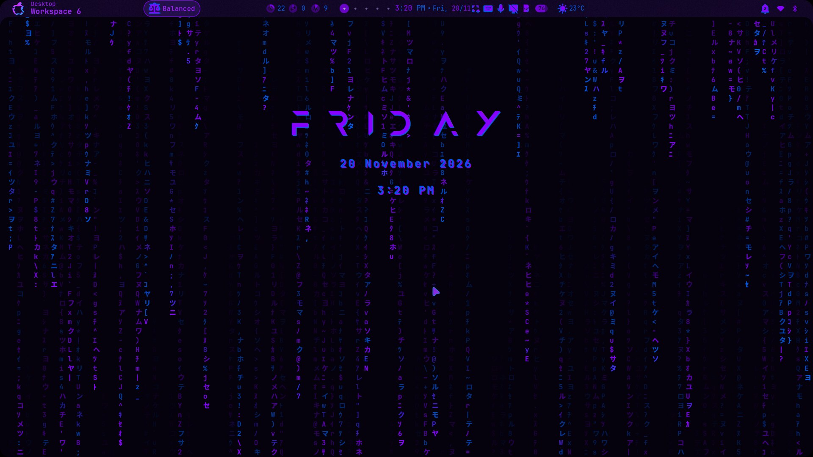
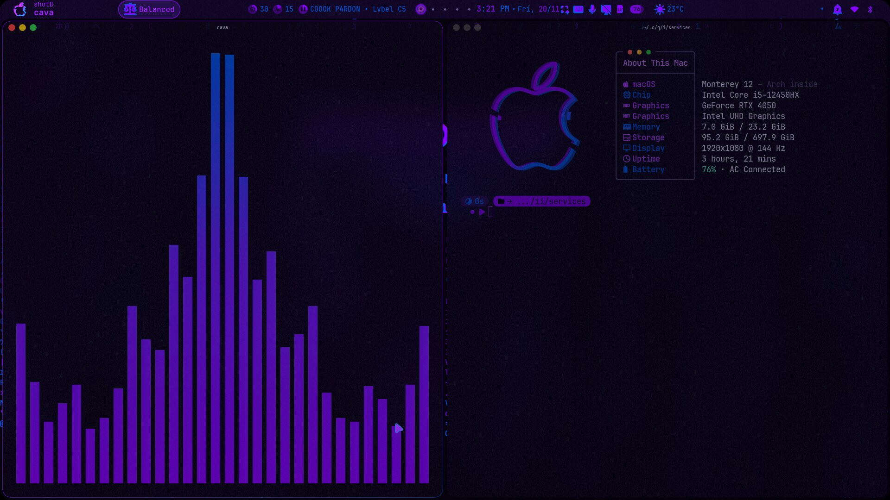
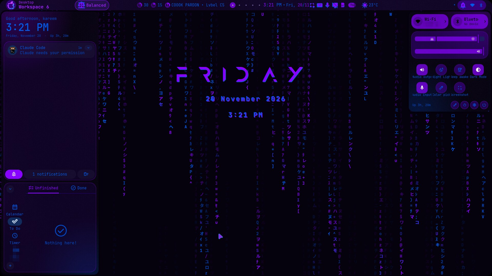

# Kareem's Arch rice

Hyprland + [end-4 dots-hyprland](https://github.com/end-4/dots-hyprland) (illogical-impulse, Quickshell), themed dark violet `#8703ff` and neon blue `#0059e7`.



| Terminal: fastfetch + cava | Sidebars |
| --- | --- |
|  |  |

Updated automatically from my machine. Made for **my** laptop (Lenovo LOQ, RTX 4050, fish shell), so read `restore.sh` before you run it.

## What's in it

- Hyprland, Quickshell (end-4 `ii`) and illogical-impulse config, with my patches
- Theme: GTK, Qt/KDE colors, Bibata-Violet cursors, fonts (JetBrains Mono, Anurati), matugen, SDDM astronaut config
- Apps: kitty, fish, starship, yazi, mpv, cava, fastfetch, bat, MangoHud, VS Code settings, Spicetify VioletNeon theme, Vesktop theme
- Scripts in `~/.local/bin` (`wp` workspaces, `tools` cheat sheet, `audio-panel`, `power-mode`, `plugins-rebuild`, autofile sorter…)
- hypr-cube patches for Hyprland 0.57 (`system/patches/hypr-cube`)
- Package lists (`packages-native.txt`, `packages-aur.txt`)

## Install

On a fresh Arch install:

```
sudo pacman -S --needed git
git clone https://github.com/kareemnubani4-beep/PU_H ~/dotfiles
DRY=1 ~/dotfiles/restore.sh   # preview: prints every step, changes nothing
~/dotfiles/restore.sh
```

What `restore.sh` does, in order:

1. Asks for sudo once.
2. Installs base tools and yay.
3. Installs end-4 at the pinned commit `2f0c8bf` (newer end-4 may not match these files).
4. Installs the packages and flatpaks (missing ones are skipped and listed).
5. Copies `home/` into `~`. Every file it replaces is saved in `~/restore-backup-<date>` first. Paths written as `/home/kareem` are changed to your home.
6. Installs `system/` files (rEFInd-first boot order service, SDDM theme, power-profile permissions), enables services, adds you to the groups.
7. Clones the extra repos into `~/Projects/Cloned` and applies the hypr-cube patches.
8. Prints what's left to do by hand.

After it finishes: reboot, log in to Hyprland, run `plugins-rebuild`. rEFInd and Spotify (`spicetify backup apply`) are manual.

Some parts are hardware-specific (Lenovo power-profile files, NVIDIA `prime-run` launch options). Skip or edit them for your machine.

## Layout

| Path | What |
| --- | --- |
| `restore.sh` | Installer |
| `home/` | Files that go in `~` |
| `system/` | /etc and /usr/local files, service, group, flatpak and repo lists, patches |
| `packages-*.txt` | Package lists |
